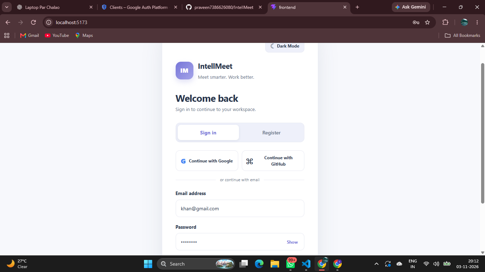
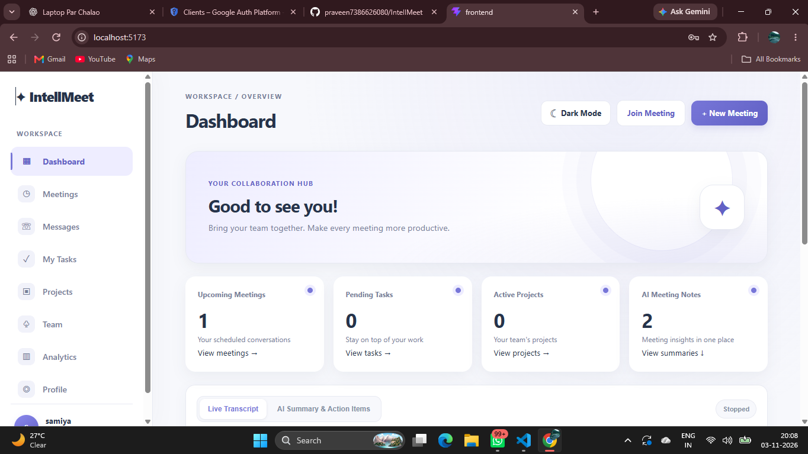
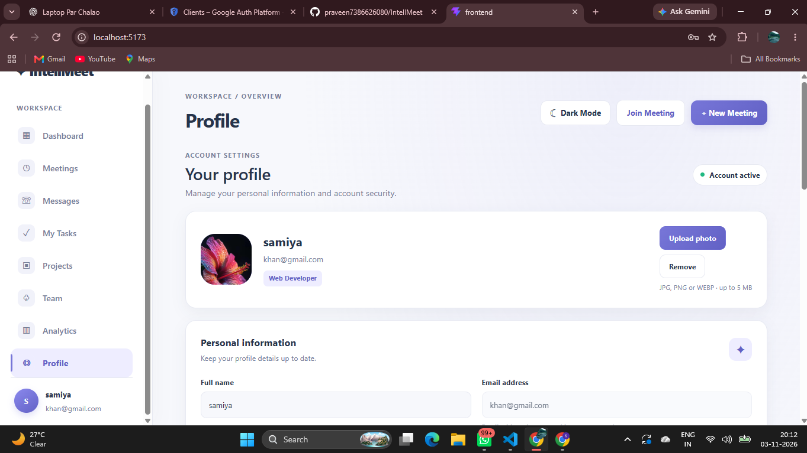
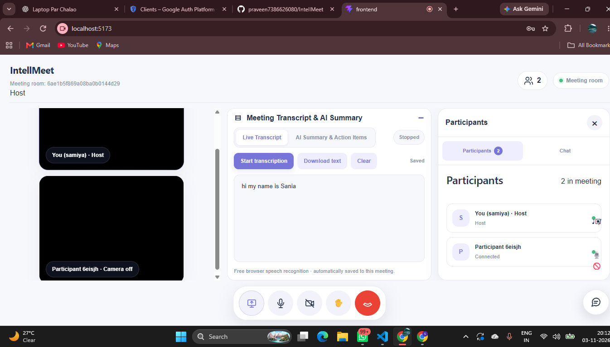

# IntellMeet – Smart Meeting & Collaboration Platform

IntellMeet is a web-based meeting and collaboration platform designed to help teams communicate, organize work, and collaborate efficiently. It provides user authentication, meeting rooms, real-time communication, workspace management, and AI-powered meeting assistance.

## Features

### Authentication & User Profile
- User registration and login.
- Google OAuth login.
- GitHub OAuth login.
- User profile management.
- Profile photo upload using Cloudinary.

### Meetings & Collaboration
- Create and schedule meetings.
- Join live meeting rooms.
- Real-time participant updates.
- Audio and video communication.
- Microphone and camera controls.
- Real-time meeting chat.
- Raise Hand functionality.
- Host-controlled meeting termination.

### Workspace Management
- Create and manage projects.
- Create and assign tasks.
- Track task status.
- Invite existing IntellMeet users to workspaces.
- Share workspace messages.
- View workspace analytics.

### AI Meeting Assistance
- Browser-based speech transcription.
- Save meeting transcripts.
- Generate meeting summaries, key decisions, and action items using a local Ollama model.

## Technology Stack

| Component | Technologies |
|---|---|
| Frontend | React, TypeScript, Vite |
| Backend | Node.js, Express.js, TypeScript |
| Real-time Communication | Socket.IO, WebRTC |
| Database | MongoDB, Mongoose |
| Authentication | Passport.js, Google OAuth, GitHub OAuth |
| Profile Image Storage | Cloudinary |
| AI Summaries | Ollama |

## Requirements

- Node.js and npm
- MongoDB Atlas or local MongoDB
- Google Chrome or Microsoft Edge
- Ollama (for AI meeting summaries)

## Installation & Setup

### 1. Clone the Repository

```bash
git clone https://github.com/praveen7386626080/IntellMeet.git
cd IntellMeet
```

### 2. Backend Setup

```bash
cd backend
npm install
```

Create a `.env` file inside the backend directory. Add your own configuration:

```env
MONGODB_URI=your_mongodb_connection_string
JWT_SECRET=your_long_random_secret
PORT=5002
CLIENT_URL=http://localhost:5173

GOOGLE_CLIENT_ID=your_google_client_id
GOOGLE_CLIENT_SECRET=your_google_client_secret
GOOGLE_CALLBACK_URL=http://localhost:5002/api/auth/google/callback

GITHUB_CLIENT_ID=your_github_client_id
GITHUB_CLIENT_SECRET=your_github_client_secret
GITHUB_CALLBACK_URL=http://localhost:5002/api/auth/github/callback

CLOUDINARY_CLOUD_NAME=your_cloud_name
CLOUDINARY_API_KEY=your_cloudinary_api_key
CLOUDINARY_API_SECRET=your_cloudinary_api_secret

OLLAMA_BASE_URL=http://localhost:11434
OLLAMA_MODEL=qwen2.5:3b
```

Use the environment variables required by your current backend configuration. Never commit `.env` or share its secrets.

Start the backend:

```bash
npm run dev
```

The local backend runs at:

`http://localhost:5002`

### 3. Frontend Setup

Open another terminal in the project root:

```bash
cd frontend
npm install
npm run dev
```

Open the local URL printed by Vite. By default:

`http://localhost:5173`

### 4. AI Meeting Summaries Setup

Install Ollama and download the configured model:

```bash
ollama pull qwen2.5:3b
```

Keep Ollama running while generating meeting summaries.

## Build

Backend:

```bash
cd backend
npm run build
```

Frontend:

```bash
cd frontend
npm run build
```

## Important Notes

- Google and GitHub OAuth require valid provider credentials and configured callback URLs.
- Google OAuth testing mode may require adding test users.
- Profile photo upload requires valid Cloudinary credentials.
- Speech recognition depends on browser support and microphone permissions.
- AI meeting summaries require Ollama and the configured model.
- Never upload `.env` files, API keys, passwords, or private credentials to GitHub.

## Repository

GitHub: https://github.com/praveen7386626080/IntellMeet

---

**IntellMeet – Meet Smarter. Work Better.**
## Application Screenshots

### Login Page


### Dashboard


### User Profile


### Live Meeting Room

